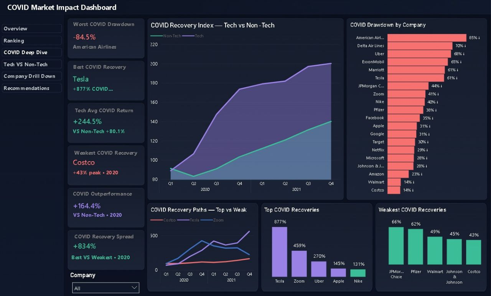
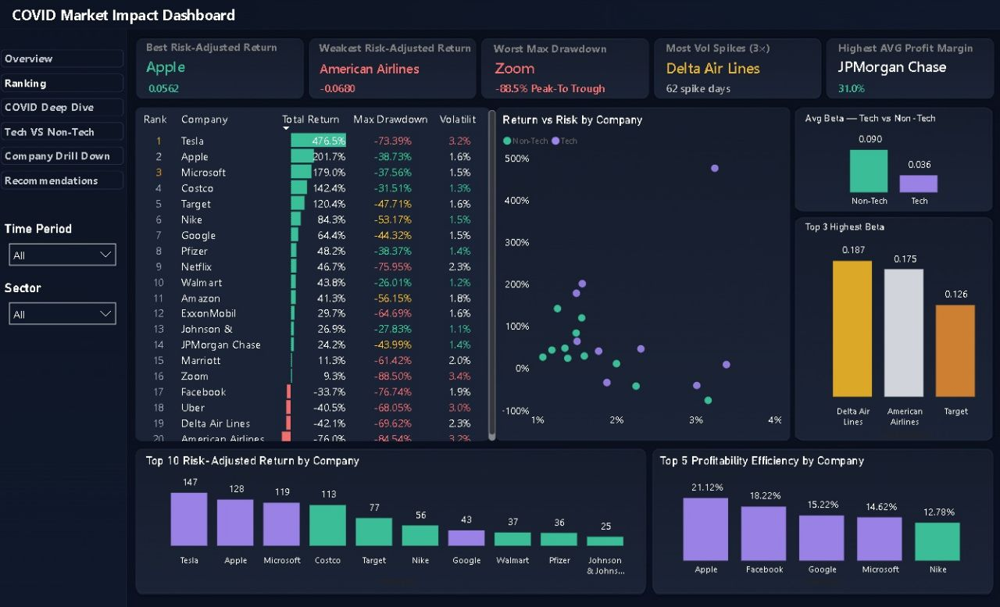
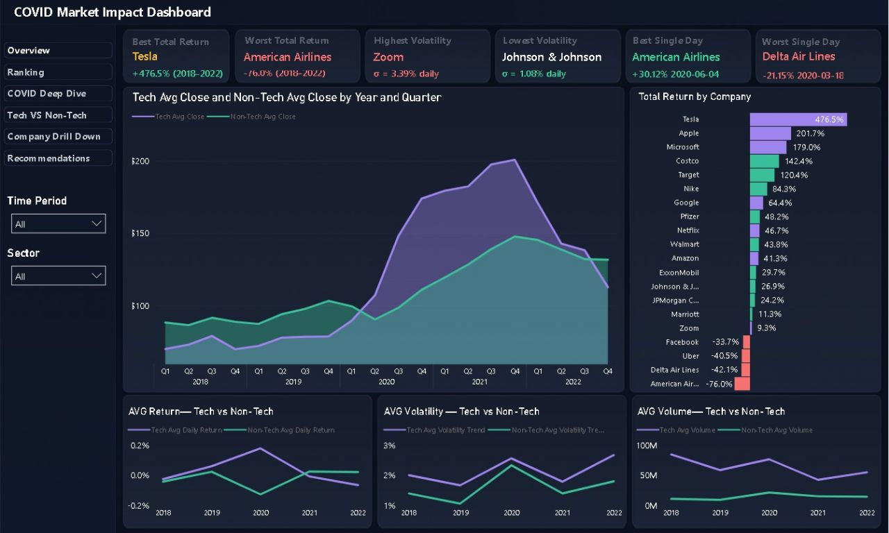
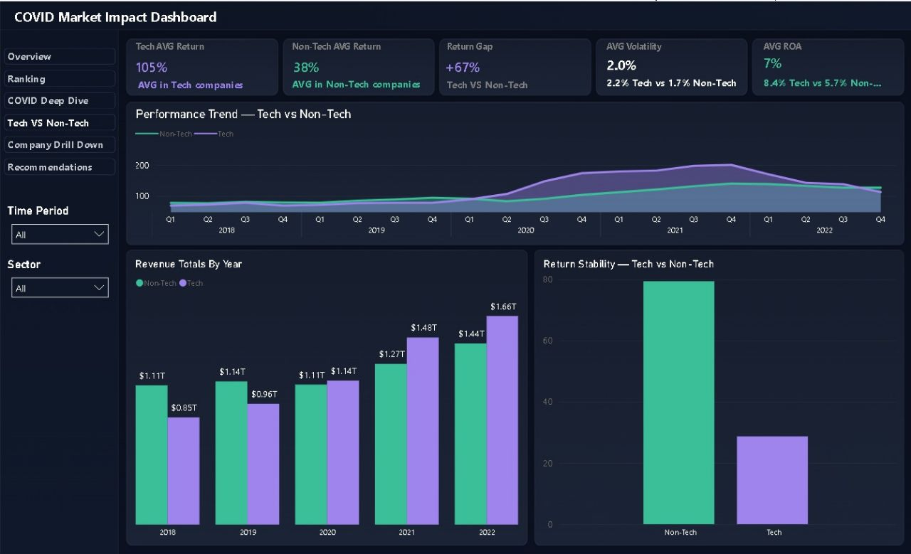
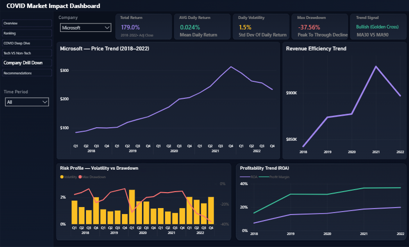
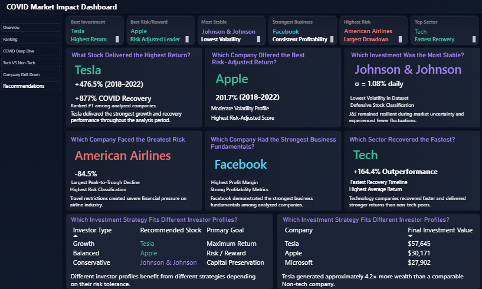

# 📊 COVID-19 Market Impact Analysis | Power BI

### Analyzing Stock Market Performance, Financial Risk & Recovery (2018–2022)

An interactive Business Intelligence project analyzing 20 major global companies across different sectors before, during, and after the COVID-19 market shock.

The project explores market performance, investment risk, recovery patterns, and differences between Technology and Non-Technology companies using interactive Power BI dashboards.

---

## 📌 Project Overview

The COVID-19 pandemic created significant disruption across global financial markets.

This project analyzes historical stock-market data from 2018 to 2022 to understand how major companies performed under market uncertainty, which companies experienced the greatest losses, and how quickly different companies recovered.

The dashboards provide an interactive view of company performance, risk indicators, and sector-level comparisons.

## 🎯 Business Questions

- Which companies achieved the highest and lowest total returns?
- Which companies experienced the greatest volatility and maximum drawdowns?
- How did Technology companies perform compared with Non-Technology companies?
- Which companies demonstrated stronger recovery patterns after the COVID-19 shock?
- How did company performance and risk change over time?
- Which companies showed stronger risk-adjusted performance?

## 🛠️ Tools & Technologies

- Microsoft Power BI
- DAX
- Power Query
- Data Cleaning & Transformation
- Data Modeling
- Financial Performance Analysis
- Data Visualization
- CSV Datasets

## 📈 Dashboard Preview

### 1. Overview Dashboard

A high-level view of company performance, total returns, market trends, and Technology versus Non-Technology comparisons.

### 2. Company Ranking & Risk Analysis

Compares company returns, volatility, maximum drawdowns, and risk-adjusted performance.

### 3. COVID-19 Recovery Analysis

Examines recovery patterns, drawdowns, and differences in company performance during the pandemic period.

### 4. Technology vs. Non-Technology

Compares sector performance, returns, volatility, and other financial indicators over the analysis period.

### 5. Company Performance Analysis

Provides a deeper look at company-level performance and financial indicators.

### 6. Insights & Recommendations

Highlights key analytical findings and potential business implications derived from the project.

## 🔍 Key Findings

The analysis identified several notable patterns:

- Tesla recorded the highest total return in the analyzed company group, at approximately 476.5%.
- American Airlines recorded the lowest total return, at approximately -76.0%.
- Technology companies achieved an average return of approximately 105%, compared with 38% for Non-Technology companies.
- The difference between the two sector averages was approximately 67 percentage points.
- Company risk varied considerably, with differences in volatility and maximum drawdown across the analyzed companies.
- Recovery patterns differed significantly across companies following the market shock.

*These findings refer to the companies and historical period included in this project; they should not be interpreted as predictions of future market performance.*

## 💡 Business Value

This project demonstrates how interactive dashboards can help users:

- Compare company performance across multiple years.
- Identify companies with higher historical returns and greater downside risk.
- Evaluate differences between sectors.
- Explore recovery trends after a major market disruption.
- Turn historical financial data into accessible visual insights.

## 📁 Project Files

- [Power BI Dashboard (.pbix)](Covid%20Market%20Impact.pbix)
- [Project Presentation (.pptx)](Project-Presentation.pptx)

## 👨‍💻 Author

**Mohamed Atef**

Data Analyst | Business Intelligence | Power BI Developer

Interested in transforming raw data into meaningful insights that support better business decisions.

- [GitHub Profile](https://github.com/moddeatef123-cmd)
